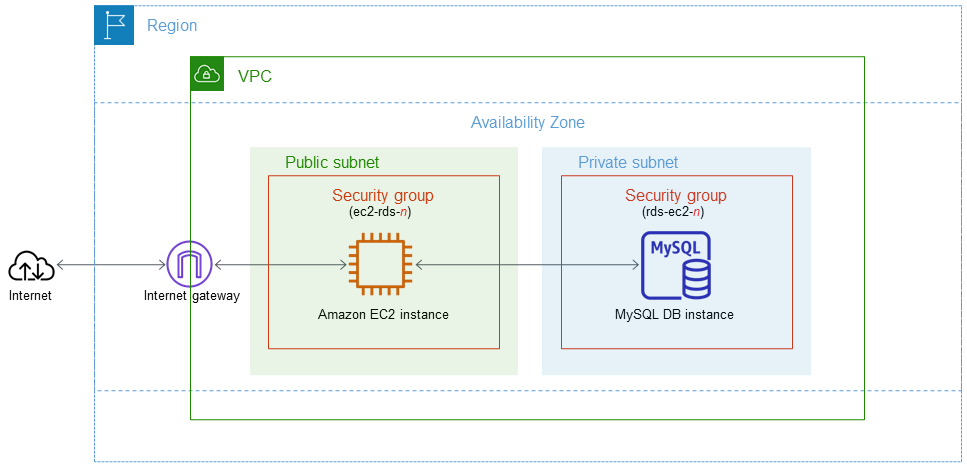

# AWS Lab – Amazon RDS Multi-AZ với EC2

Lab thực hành triển khai **Amazon RDS với Multi-AZ** và kết nối cơ sở dữ liệu với ứng dụng chạy trên **Amazon EC2**.

🔗 **Lab hướng dẫn:** https://000005.awsstudygroup.com/

## 🎯 Mục tiêu

* Tạo VPC và các thành phần networking cần thiết
* Cấu hình Security Group và DB Subnet Group
* Triển khai **Amazon RDS với Multi-AZ**
* Khởi tạo EC2 instance
* Kết nối ứng dụng trên EC2 với RDS
* Kiểm tra kết nối đến database
* Thực hành backup và restore RDS
* Xóa các tài nguyên AWS sau khi hoàn thành lab

## 🏗️ Kiến trúc

> RDS Multi-AZ duy trì một bản standby ở Availability Zone khác và có thể tự động chuyển đổi (failover) khi database primary gặp sự cố.

## 🛠️ AWS Services

| Service             | Vai trò                             |
| ------------------- | ----------------------------------- |
| **Amazon VPC**      | Xây dựng mạng riêng cho hệ thống    |
| **Amazon EC2**      | Chạy ứng dụng/Web Server            |
| **Amazon RDS**      | Cung cấp cơ sở dữ liệu được quản lý |
| **RDS Multi-AZ**    | Đảm bảo tính sẵn sàng cao           |
| **Security Groups** | Kiểm soát traffic                   |
| **DB Subnet Group** | Xác định các subnet dành cho RDS    |

## 📚 Kiến thức thực hành

* VPC và kiến trúc Subnet
* Public Subnet và Private Subnet
* Security Group
* Kết nối **EC2 → RDS**
* RDS Multi-AZ và High Availability
* Database replication và automatic failover
* Backup và Restore RDS
* Managed Database vs. Self-managed Database

## 🔗 Tài liệu tham khảo

* [AWS Study Group – Amazon RDS Lab](https://000005.awsstudygroup.com/)
* [Amazon RDS Multi-AZ Documentation](https://docs.aws.amazon.com/AmazonRDS/latest/UserGuide/Concepts.MultiAZ.html)
