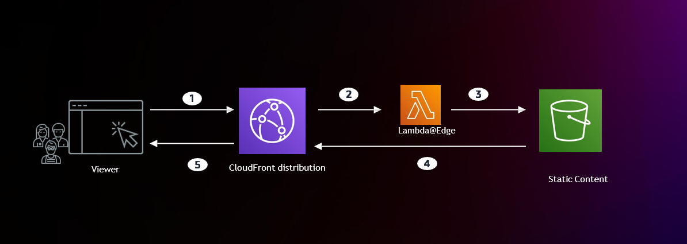

# AWS Lab – Amazon CloudFront & Lambda@Edge

Lab thực hành triển khai **Amazon CloudFront** với hai loại origin là **Amazon S3** (nội dung tĩnh) và **Amazon EC2** (API động), sau đó mở rộng bằng **Origin Group**, **Custom Error Page**, **Response Headers Policy** và xử lý request tại edge bằng **Lambda@Edge**.

🔗 **Lab hướng dẫn:** https://000130.awsstudygroup.com/

## 🎯 Mục tiêu

* Tạo **EC2 instance** chạy API Node.js/Express (`/api`) trên port 80
* Tạo **S3 bucket** chứa `index.html` làm origin nội dung tĩnh
* Tạo **CloudFront Distribution** với S3 origin, truy cập qua **Origin Access Control (OAC)**
* Thêm **EC2 origin** và cache behavior `/api` (CachingDisabled + AllViewer)
* Kiểm tra cache qua các header `x-cache`, `x-amz-cf-pop`, `x-amz-cf-id`
* Thực hành **Invalidation** để làm mới cache
* Cấu hình **Custom Error Response** cho lỗi 403 và 504 với `/error.html`
* Tạo **Origin Group** với S3 bucket thứ hai ở region khác để failover (403/404)
* Gắn **Response Headers Policy** (Security headers) vào default behavior
* Tạo hàm **Lambda@Edge** ở `us-east-1` và gắn vào behavior `/serverless` (Origin request)
* Theo dõi **CloudWatch Metrics & Logs** của Lambda@Edge
* Xóa các tài nguyên AWS sau khi hoàn thành lab

## 🏗️ Kiến trúc

> Người dùng truy cập **CloudFront** qua HTTPS (HTTP được redirect sang HTTPS). Default behavior `*` trỏ đến **Origin Group** gồm S3 bucket chính và S3 bucket phụ (failover khi gặp 403/404), cả hai chỉ cho phép CloudFront đọc qua **OAC**. Behavior `/api` và `/serverless` chuyển tiếp đến **EC2 origin** (HTTP only) mà không cache; riêng `/serverless` được **Lambda@Edge** (Origin request) xử lý và trả về trang HTML liệt kê các request header ngay tại edge.

## 🛠️ AWS Services

| Service                        | Vai trò                                                        |
| ------------------------------ | -------------------------------------------------------------- |
| **Amazon CloudFront**          | CDN phân phối nội dung tĩnh và động qua các edge location      |
| **Origin Access Identity**     | Chỉ cho phép CloudFront đọc object trong S3 bucket             |
| **Amazon S3**                  | Lưu `index.html`, `error.html` và trang failover ở bucket phụ  |
| **Amazon EC2**                 | Chạy API Node.js/Express (PM2) làm custom origin               |
| **Security Groups**            | Kiểm soát traffic HTTP/SSH đến EC2                             |
| **AWS Lambda (Lambda@Edge)**   | Xử lý request tại edge cho behavior `/serverless`              |
| **AWS IAM**                    | Execution role cho Lambda@Edge                                 |
| **Amazon CloudWatch**          | Metrics và Logs của Lambda@Edge                                |

## 📚 Kiến thức thực hành

* **CloudFront Distribution và Origins (S3, EC2)**
* **Origin Access Identity (OAI) và S3 Bucket Policy**
* **Cache Behavior và Path Pattern**
* **Managed Cache Policy (CachingOptimized, CachingDisabled)**
* **Managed Origin Request Policy (AllViewer)**
* **Viewer Protocol Policy (Redirect HTTP to HTTPS)**
* **Cache Invalidation**
* **Custom Error Response và Error Caching TTL**
* **Origin Group và Origin Failover**
* **Response Headers Policy (Security headers)**
* **Lambda@Edge (Origin request trigger, versioning, replicas)**
* **CloudWatch Metrics và Logs cho Lambda@Edge**

## 🔗 Tài liệu tham khảo

* [AWS Study Group – CloudFront Lab](https://000130.awsstudygroup.com/)
* [Amazon CloudFront Documentation](https://docs.aws.amazon.com/AmazonCloudFront/latest/DeveloperGuide/Introduction.html)
* [Lambda@Edge Documentation](https://docs.aws.amazon.com/AmazonCloudFront/latest/DeveloperGuide/lambda-at-the-edge.html)
