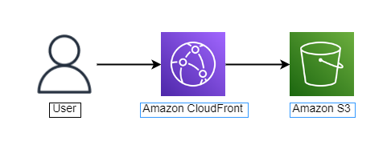

# AWS Lab – Static Website với Amazon S3 & Amazon CloudFront

Lab thực hành lưu trữ nội dung web tĩnh trên **Amazon S3** và phân phối qua **Amazon CloudFront** để bảo vệ bucket và tăng tốc độ truy cập cho người dùng.

🔗 **Lab hướng dẫn:** https://000094.awsstudygroup.com/

## 🎯 Mục tiêu

* Tạo **S3 Bucket** private tại region `ap-southeast-1` (Singapore)
* Giữ **Block all public access** và bật **Bucket Versioning**
* Tải lên file **index.html** làm nội dung web tĩnh
* Tạo **CloudFront Distribution** với S3 bucket làm origin
* Chỉ cho phép CloudFront đọc bucket private (**Origin Access Control**)
* Cấu hình **Default Root Object** là `index.html`
* So sánh thời gian tải trang giữa S3 object URL và CloudFront domain
* Kiểm tra edge location phục vụ request qua header `X-Amz-Cf-Pop`
* Xóa các tài nguyên AWS sau khi hoàn thành lab

## 🏗️ Kiến trúc

> Người dùng truy cập **CloudFront Distribution Domain Name**. Request được phục vụ từ **edge location** gần nhất; khi cache miss, CloudFront lấy nội dung từ **S3 bucket private** thông qua **Origin Access Control**. Bucket không mở public, chỉ CloudFront mới có quyền đọc object.

## 🛠️ AWS Services

| Service                      | Vai trò                                             |
| ---------------------------- | --------------------------------------------------- |
| **Amazon S3**                | Lưu trữ nội dung web tĩnh (`index.html`)            |
| **S3 Bucket Versioning**     | Lưu nhiều phiên bản object, khôi phục khi xóa/sửa nhầm |
| **S3 Block Public Access**   | Giữ bucket ở chế độ private                         |
| **Amazon CloudFront**        | CDN phân phối và cache nội dung tại edge locations  |
| **Origin Access Control**    | Cho phép CloudFront đọc object trong bucket private |
| **S3 Bucket Policy**         | Cấp quyền `s3:GetObject` cho CloudFront distribution |

## 📚 Kiến thức thực hành

* **S3 Bucket** và quy tắc đặt tên bucket
* **Block Public Access** và bucket private
* **Bucket Versioning**
* **CloudFront Distribution** và **S3 Origin**
* **Origin Access Control (OAC)** và bucket policy
* **Default Root Object**
* **Edge Locations / Points of Presence (PoP)**
* So sánh **latency** giữa S3 trực tiếp và CloudFront
* Quy trình dọn dẹp: **Disable → Delete** distribution, **Empty → Delete** bucket

## 🔗 Tài liệu tham khảo

* [AWS Study Group – S3 & CloudFront Lab](https://000094.awsstudygroup.com/)
* [Amazon S3 User Guide](https://docs.aws.amazon.com/AmazonS3/latest/userguide/Welcome.html)
* [Amazon S3 Bucket Versioning](https://docs.aws.amazon.com/AmazonS3/latest/userguide/Versioning.html)
* [Amazon CloudFront Developer Guide](https://docs.aws.amazon.com/AmazonCloudFront/latest/DeveloperGuide/Introduction.html)
* [Restricting access to an Amazon S3 origin (OAC)](https://docs.aws.amazon.com/AmazonCloudFront/latest/DeveloperGuide/private-content-restricting-access-to-s3.html)
