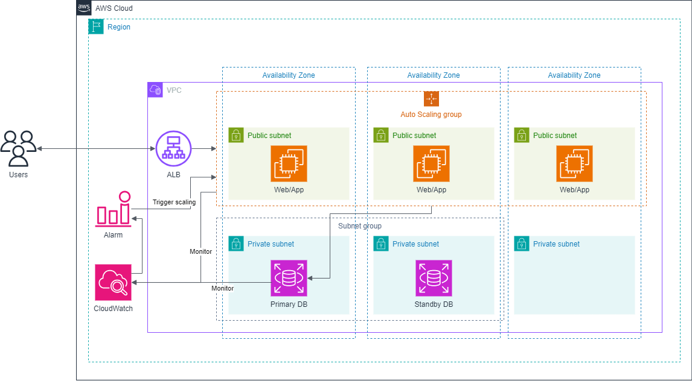

# AWS Lab – EC2 Auto Scaling & Elastic Load Balancing

Lab thực hành triển khai **Amazon EC2 Auto Scaling** kết hợp với **Elastic Load Balancing (ELB)** để tự động điều chỉnh số lượng EC2 instance và phân phối traffic đến application tier.

🔗 **Lab hướng dẫn:** https://000006.awsstudygroup.com/

## 🎯 Mục tiêu

* Tạo **Launch Template** cho EC2 instance
* Cấu hình **Auto Scaling Group (ASG)**
* Thực hành các chiến lược **Manual Scaling** và **Dynamic Scaling**
* Cấu hình **Target Tracking Scaling** dựa trên CPU utilization
* Tạo **Application Load Balancer (ALB)**
* Cấu hình **Target Group** và health check
* Phân phối traffic đến các EC2 instances trong ASG
* Kiểm tra khả năng **scale out / scale in**
* Xóa các tài nguyên AWS sau khi hoàn thành lab

## 🏗️ Kiến trúc

> **Application Load Balancer** phân phối traffic đến các EC2 instances trong **Target Group**. **Auto Scaling Group** tự động điều chỉnh số lượng instances dựa trên cấu hình scaling policy và tải của ứng dụng.

## 🛠️ AWS Services

| Service                       | Vai trò                                    |
| ----------------------------- | ------------------------------------------ |
| **Amazon VPC**                | Xây dựng mạng cho hệ thống                 |
| **Amazon EC2**                | Chạy ứng dụng/Web Server                   |
| **EC2 Launch Template**       | Định nghĩa cấu hình EC2 instance           |
| **EC2 Auto Scaling**          | Tự động điều chỉnh số lượng EC2 instances  |
| **Application Load Balancer** | Phân phối traffic đến các instances        |
| **Target Group**              | Quản lý các EC2 instances và health checks |
| **Amazon CloudWatch**         | Cung cấp metrics cho scaling               |
| **Security Groups**           | Kiểm soát traffic                          |

## 📚 Kiến thức thực hành

* **EC2 Launch Template**
* **Auto Scaling Group (ASG)**
* **Scale Out / Scale In**
* **Manual Scaling**
* **Dynamic Scaling**
* **Target Tracking Scaling**
* **Application Load Balancer (ALB)**
* **Target Group và Health Check**
* **High Availability với nhiều Availability Zones**
* **CloudWatch metrics và Auto Scaling**
* **Load Balancing và traffic distribution**

## 🔗 Tài liệu tham khảo

* [AWS Study Group – EC2 Auto Scaling Lab](https://000006.awsstudygroup.com/)
* [Amazon EC2 Auto Scaling Documentation](https://docs.aws.amazon.com/autoscaling/ec2/userguide/what-is-amazon-ec2-auto-scaling.html)
* [Elastic Load Balancing Documentation](https://docs.aws.amazon.com/elasticloadbalancing/latest/application/introduction.html)
